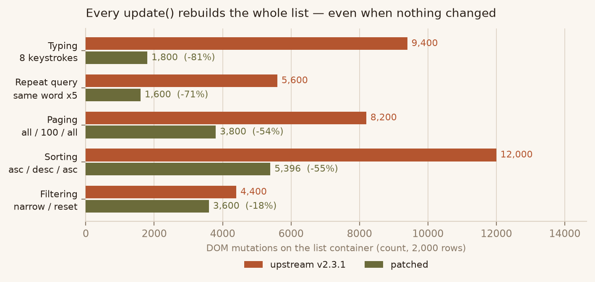
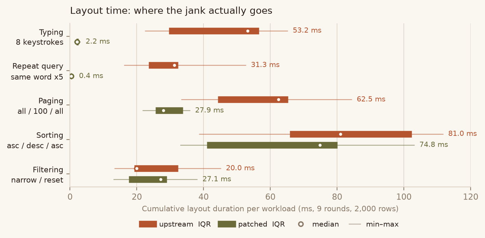
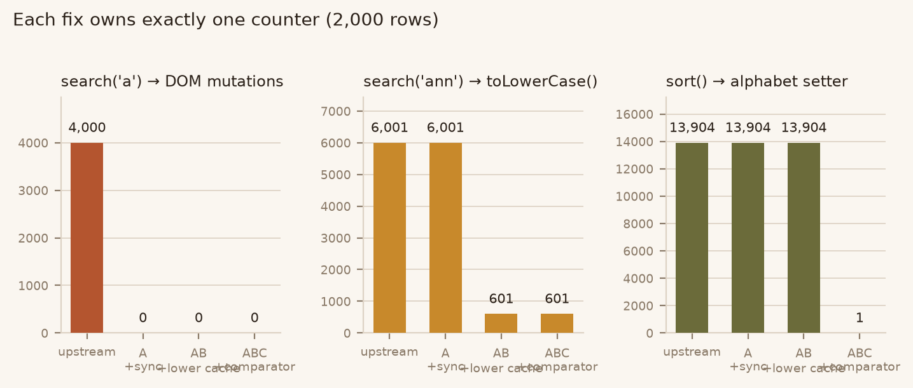

# list.js — incremental DOM sync for the list redraw path

An optimization branch of [list.js](https://github.com/javve/list.js) v2.3.1. The public API is unchanged; only three wastes on the redraw path were removed.

**The problem in one line:** `update()` tears every child out of the list container and appends the visible ones back, so a 2,000-row list pays 4,000 DOM mutations even when the visible set and its order did not change.



*2,000 rows, median of 9 interleaved rounds. Counts measured in-page by patching `appendChild` / `removeChild` / `insertBefore` on the container. Source: `results/summary.json` → `browser.n2000.workloads.*.domTotal`.*

## What changed

| # | File | Change |
|---|---|---|
| A | `src/templater.js`, `src/index.js`, `src/search.js` | New `templater.sync(items)`: tag target nodes with a round token, single pass to drop non-target children, single forward scan to place survivors with `insertBefore`. `update()` now collects the target sequence and syncs instead of `clear()` + append. Also drops a redundant `templater.clear()` in `prepare.resetList()` — every search used to empty the container twice. |
| B | `src/search.js` | Per-`(item, column)` lowercase cache, validated against the exact source string it was built from, so a rewritten value invalidates it automatically. `item.values()` hoisted out of the column loop. |
| C | `src/sort.js` | `naturalSort` selection, `alphabet` assignment and `insensitive` check hoisted out of the comparator. `alphabet` is a setter that rebuilds the whole index map on every assignment. |

No `Set` / `WeakMap` / arrow functions — `.browserslistrc` still says `ie 9`.

## Results



*Thick bar = IQR, thin line = min–max, white dot = median. 9 rounds, 2,000 rows, fresh browser context per sample, `document.body.offsetHeight` read after every step so each operation's layout is settled individually. Source: `results/summary.json` → `browser.n2000.workloads.*.layoutDurationMs`.*

| Workload (2,000 rows) | DOM mutations | Layout ms | Style recalc ms | Verdict |
|---|---|---|---|---|
| Typing, 8 keystrokes | 9,400 → **1,800** | 53.2 → **2.2** | 27.2 → **0.2** | IQR separated |
| Paging all/100/all | 8,200 → **3,800** | 62.5 → **27.9** | 31.8 → **13.6** | IQR separated |
| Repeat same query ×5 | 5,600 → **1,600** | 31.3 → **0.4** | 15.0 → **0.0** | IQR separated |
| Sorting asc/desc/asc | 12,000 → 5,396 | 81.0 → 74.8 | 47.7 → 40.8 | **not measurable** |
| Custom `alphabet` sort | 8,000 → 3,600 | 56.0 → 44.5 | 35.0 → 27.6 | trend only |
| Filter narrow/reset | 4,400 → 3,600 | 20.0 → 27.1 | 14.6 → 12.4 | **not measurable** |

At 5,000 rows the same shape holds: typing goes 139.7 → 5.9 ms layout, paging 152.4 → 75.3 ms.

A result is only reported as a win when `patched.q3 < upstream.q1` (IQRs do not overlap at all). Everything else is recorded as not measurable, not as a small win.

## Attribution



Three incremental builds isolate each fix: `A` = sync only, `AB` = plus lowercase cache, `ABC` = plus comparator hoisting. The relationship is orthogonal — DOM counts move only with A, `toLowerCase()` counts only with B, the `alphabet` setter only with C (13,904 → 1). Source: `results/summary.json` → `arms.*.steps.*`.

## Correctness

**Differential equivalence.** 32-step API sequence — multi-prefix searches, filter narrow/reset, sorts on three columns including `insensitive: false`, paging round-trip, `add`, `remove`, in-place `values()` rewrite then re-search, fuzzy search, `reIndex`, custom `alphabet`, custom `sortFunction`. After each step the harness records the container's per-node `outerHTML`, the `visibleItems` / `matchingItems` value sequences, every item's `found` / `filtered` flag, and `toJSON()`. Both arms produce a byte-identical 1,200,320-byte snapshot (sha256 `e233fe32…68bc`).

**Tests.** Upstream suite: 168 passed / 1 skipped. This branch: 168 passed / 1 skipped, plus 9 new tests in `__test__/dom-churn.test.js`. Dropping that file onto upstream `src/` makes the first 3 fail (they assert the DOM-mutation budget) and leaves the other 6 green (they assert semantics: order, non-item children still dropped, empty result empties the container, cache invalidation, add/remove sync). A test that passes on both arms would be worthless as evidence — these do not.

## Negative result: sorting did not get faster

DOM mutations dropped 55% (12,000 → 5,396) but layout and script time IQRs overlap at both sizes.

`insertBefore` moving an existing node and `removeChild` + `appendChild` both detach the node from the document, so both invalidate style and force relayout; `insertBefore` additionally has to locate the sibling. Fewer operations, same cost. Reporting this as a win on operation counts alone would have been wrong — the real cost of reordering is that every moved row must be laid out again, which needs virtual scrolling or `transform` offsets, not a smaller mutation count.

The same reasoning killed a fourth candidate: pre-extracting and pre-lowercasing sort keys. It cut `toLowerCase()` calls from 27,808 to 2,000, but the end-to-end `scriptMs` ratio was 1.06 with overlapping IQRs, so it was reverted rather than kept for the counter.

## Reproduce

```bash
npm install
npx jest                                   # 168 passed / 1 skipped + 9 new
NODE_OPTIONS=--openssl-legacy-provider npm run build

npm run count                              # deterministic counters (jsdom)
npm run equiv                              # differential snapshot

npm i -D playwright                        # uses system Edge, no browser download
npm run bench                              # 9 rounds x 2,000 rows
npm run bench:summary
```

`--openssl-legacy-provider` is for Node 17+ with webpack 5.6 (md4); unrelated to these changes. The browser bench and the equivalence harness expect an upstream v2.3.1 checkout at `../upstream`.

## Files

```
src/            patched sources
__test__/       upstream tests + dom-churn.test.js
patches/        unified diff vs v2.3.1 (-p1, LF)
bench/          Playwright + CDP benchmark, aggregator
probe/          counters, differential harness, arm builder
results/        summary.json + raw samples
docs/figures/   charts
REPORT.md       full write-up (Chinese)
NOTICE.md       change declaration
```

## License

MIT, see `LICENSE` — byte-identical to upstream (1,108 bytes, sha256 `52803c32…6261`). Changes are declared in `NOTICE.md`.
